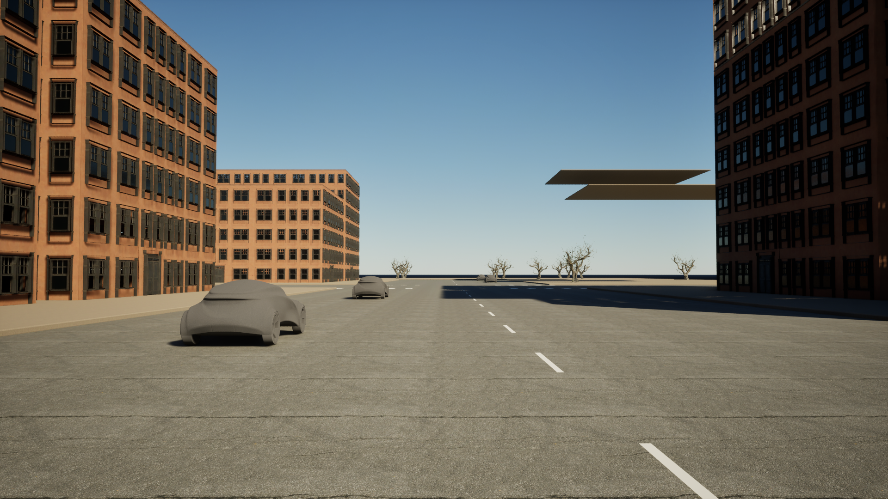
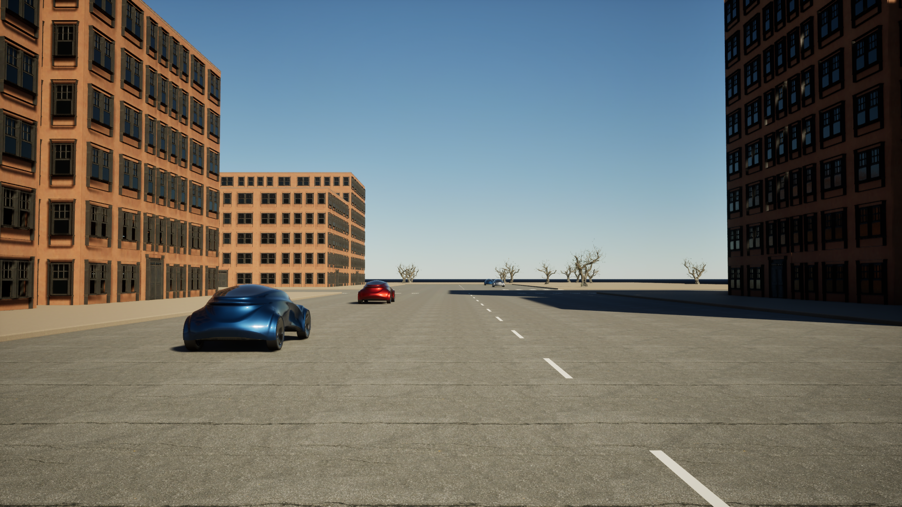
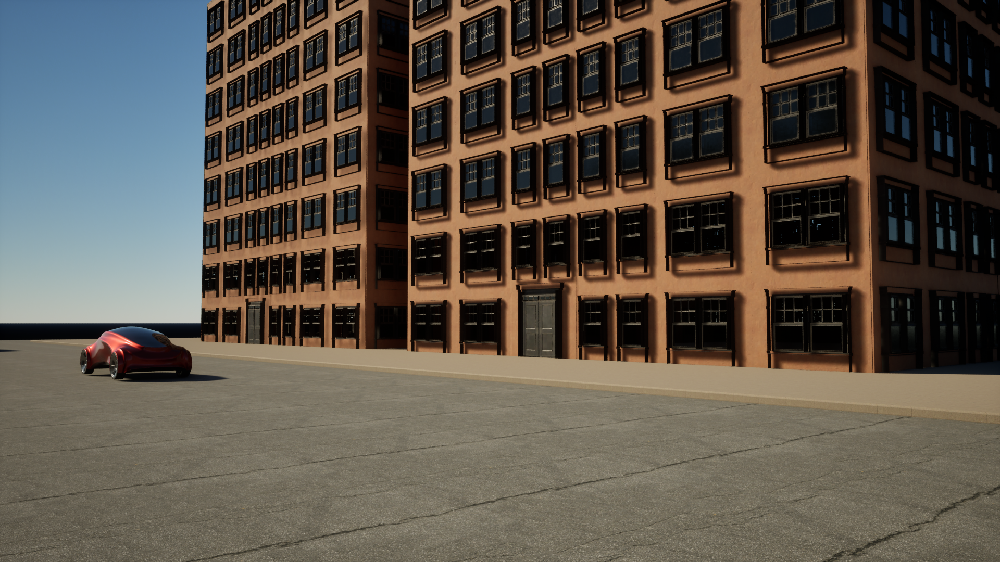
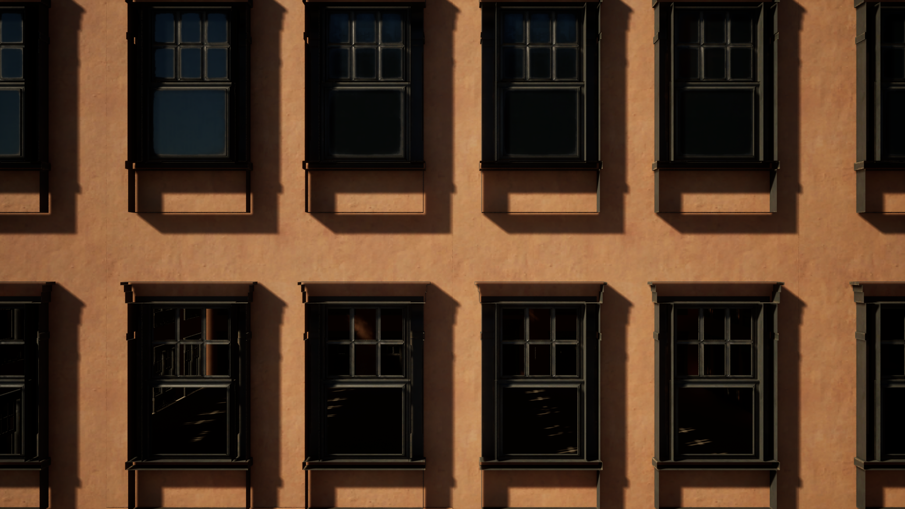
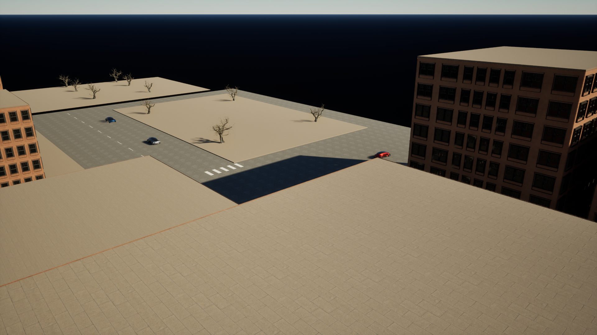
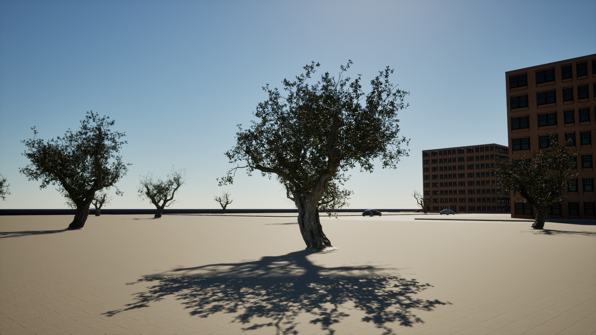

# S2.5 — evidencia visual real, no aceptación final

Las imágenes son capturas sin retoque de Unreal 5.8.4. La escena contiene mallas reales de fachada, ConceptCar, árbol CC0 y superficies PBR. Sigue siendo un laboratorio austero: no se alcanzó el objetivo artístico solicitado.

## Cambio comprobado dentro de esta sesión

Misma cámara de avenida, FOV65, altura1,7m y sol. Antes: pintura ausente y azoteas reflejadas. Después: materiales reparados y azoteas alineadas. El antes corresponde a la primera ejecución de este laboratorio, **no a Lvl_IB_C00 ni a una captura del Sprint 2**.

## Cinco vistas revisadas

| Vista | Siluetas | Materiales | Iluminación | Coches | Vegetación |
|---|---|---|---|---|---|
| Avenida | Corredor legible; edificios demasiado repetidos | Asfalto y pintura visibles; poca variedad de fachada | Sombras legibles, laterales oscuros | Formas reconocibles y pintura azul/roja; un solo modelo | Copas lejanas poco densas; revisar LOD/coste |
| Esquina | Entrada y esquina visibles; falta detalle de calle | PBR visible, predominio de un acabado | Contraste alto; revisar luz indirecta | Coche rojo ahora dentro del encuadre | Fuera del encuadre; no evaluable aquí |
| Fachada a 10m | Marcos y molduras reales; módulos repetitivos | Pared con textura, interiores demasiado oscuros | Relieve visible; sombra/interiores por mejorar | Fuera del encuadre | Fuera del encuadre |
| Azotea | Techos alineados; horizonte vacío y composición poco urbana | Techo reutiliza pavimento; necesita acabado propio | Distribución de sombras visible | Coches pequeños al fondo | Plaza/parque vacío; especie repetida |
| Parque | Tronco y copa reales, sin conos/cilindros | Corteza y hojas visibles; exceso de pavimento | Contraluz y sombra de árbol visibles | Solo al fondo | LOD0 forzado provisional; falta sotobosque y diversidad |

### Esquina con coche

### Fachada a 10m

### Azotea mirando el conjunto

### Parque

[Transformaciones/FOV y ajustes](IB_S25_IMAGES/capture.json) · [Hashes y bytes](IB_S25_IMAGES/manifest.json) · [Repetición de autoría](IB_S25_VALIDATION.json).

La comparación visual directa contra City Sample queda pendiente: su documentación oficial fue consultada, pero no se pudo recuperar la captura enlazada por un desafío de acceso. Estas imágenes no prueban 60 FPS; no se obtuvo benchmark A/B ni aceptación artística.
