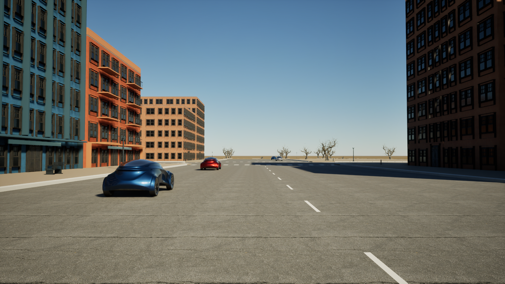
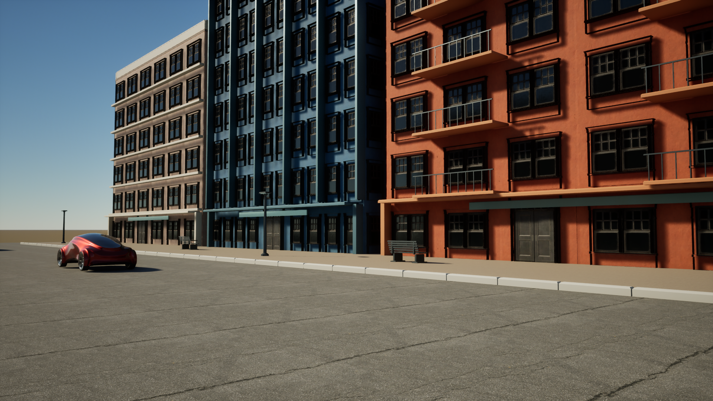
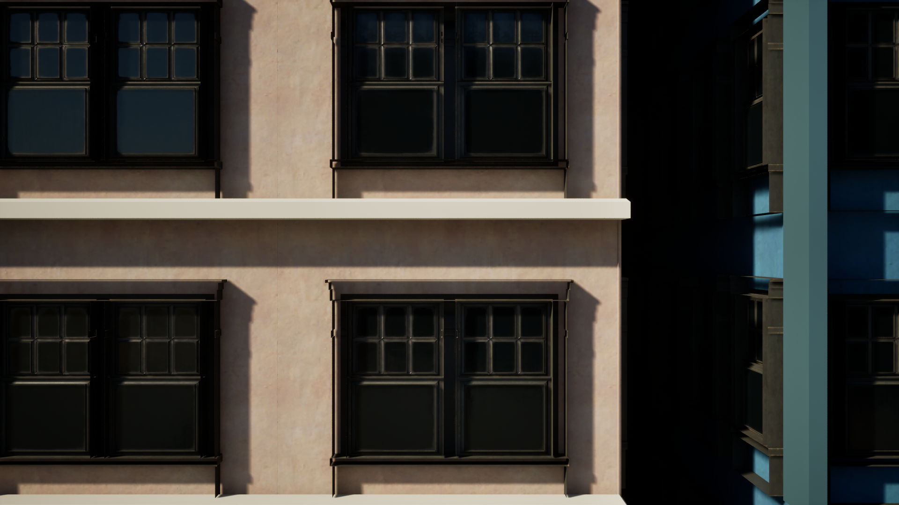
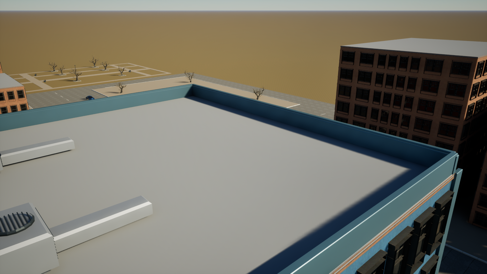
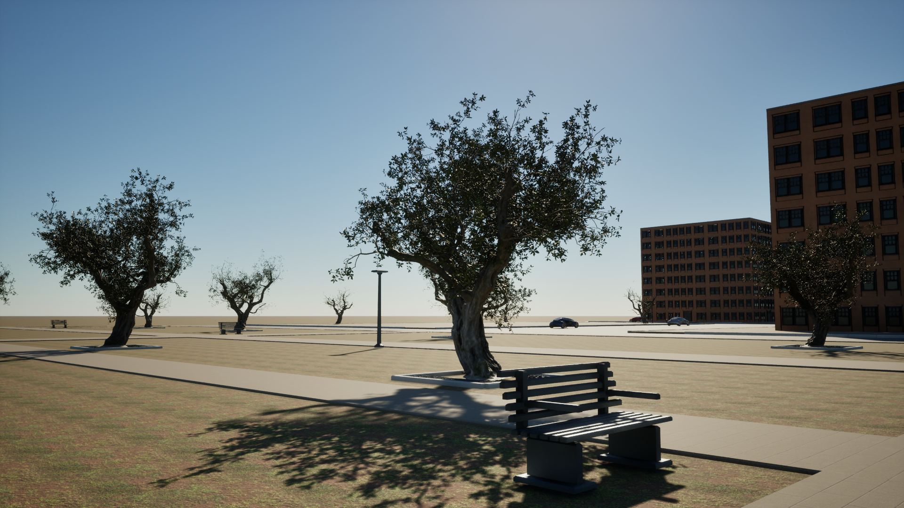
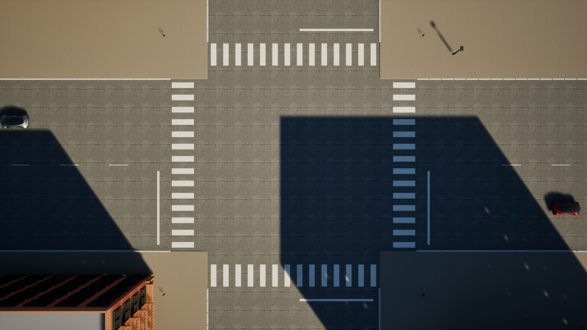

# S2.5 R2 — cinco vistas comparables, QA pendiente

Capturas nativas sin retoque de Unreal 5.8.4. Se refinó una manzana y el parque; **no se declara alcanzado el realismo**. Revisión del mismo agente que implementó, no QA independiente. [Detalles técnicos y reproducción](IB_S25_R2_REVIEW.md).

Posiciones, alturas, rotaciones y FOV coinciden con R1; EV14, sol -32/-35 y 65.000 lux. SkyLight cambia de 1 a 1,25, declarado para comparar con honestidad. [Metadatos](IB_S25_R2_IMAGES/capture.json), [hashes de PNG](IB_S25_R2_IMAGES/manifest.json).

| Vista | Cambio visual observado | Limitación que persiste |
|---|---|---|
| Avenida | Acabados azul/arcilla, ritmos distintos, marquesinas, bancos y bordillos; siluetas/pinturas de coches conservadas | Calle vacía; fachadas secundarias repetitivas; follaje lejano escaso y sombras laterales intensas |
| Esquina con coches | Tres fachadas: bandas claras, aletas azules y balcones de arcilla; entradas, mobiliario y coche rojo visibles | Ventanas del mismo kit, rótulos genéricos y calle todavía austera |
| Fachada a 10 m | Cristal sin diagonales; bandas, superficie clara y sombras de marcos legibles | Vidrio oscuro sin interior aparente; se retiró el efecto defectuoso, no se reparó toda su proyección |
| Azotea hacia centro | Parapeto, equipo/ventilador/conductos parcialmente visibles; franja negra eliminada | Equipo recortado por la cámara conservada; cubiertas secundarias vacías y fondo plano provisional |
| Parque | Tierra con textura, caminos, alcorques, banco de lamas y luminarias; copas cercanas y sombras visibles | Poca diversidad vegetal, textura repetitiva, fuerte contraste y coste sin medir |

## 1. Avenida

[Antes R1, misma cámara](IB_S25_IMAGES/01_avenue.png)

## 2. Esquina con coches

[Antes R1, misma cámara](IB_S25_IMAGES/02_corner_cars.png)

## 3. Fachada a 10 metros

[Antes R1, misma cámara](IB_S25_IMAGES/03_facade_10m.png). [Control A/B con cristal original, antes de reconstruir la manzana](IB_S25_R2_IMAGES/07_window_glass_control.png). [Material intermedio rechazado por manchas oscuras](IB_S25_R2_IMAGES/08_rejected_shader.png).

## 4. Azotea mirando el centro

[Antes R1, misma cámara](IB_S25_IMAGES/04_rooftop.png)

## 5. Parque

[Antes R1, misma cámara](IB_S25_IMAGES/05_park.png)

## Evidencia adicional de intersección

Cámara temporal cenital a 75 m/FOV65, retirada después. No pertenece a la comparación de cinco cámaras. Muestra los cuatro cruces, líneas de detención y bordillos; no prueba accesibilidad ni colisión jugable.

**Separación de resultados:** autoría y capturas ejecutadas; 16 pruebas ligeras y repetición en Unreal aprobadas. Rendimiento, jugabilidad, comparación directa con City Sample y aceptación humana pendientes. RD$0. [Revisión R1 conservada](IB_S25_R1_VISUAL_REVIEW.md).
